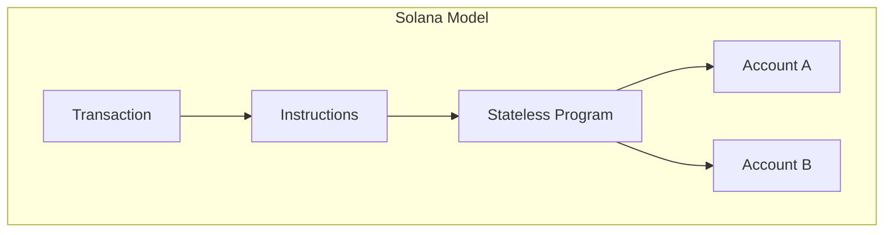
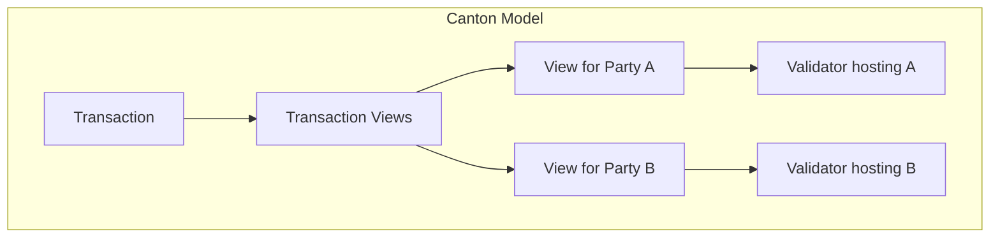

import DamlPartyRolesTemplateStructure from "/snippets/external/daml/main/tutorials-smart-contracts-daml-daml-intro-choices-daml-party-roles-template-structure-begin.mdx";

Solana separates programs from the accounts they operate on and schedules execution by declared account access. Canton bundles data and logic into contracts and keeps each contract visible only to the parties involved in it. This page maps the Solana concepts that don't carry over directly. Concepts that apply to Canton whichever chain you come from, such as privacy and authorization, are linked to their shared explanations rather than repeated here.

## Core Concept Mapping

| Solana Concept | Canton Equivalent | Canton Notes |
|-----------------|-------------------|--------------|
| Account (data + owner program + lamports) | Contract | Solana separates data from logic; a Daml template bundles both into one contract |
| Program | Template + choices | Programs are stateless and operate on accounts passed into them; templates define both the data schema and the choices that act on it |
| Instruction | Choice | A Solana transaction bundles one or more instructions; a Canton transaction exercises one or more choices |
| Program Derived Address (PDA) | [Contract key](/appdev/modules/m3-contract-keys) (closest analogue) | Every contract gets a contract ID on creation. To find a contract by a value you already know, such as an account number, define a contract key on the template. Unlike a PDA, a key isn't unique: Canton doesn't enforce key uniqueness |
| Rent / rent-exemption | No general equivalent | Contracts carry no ongoing storage charge. Canton Coin is the exception: each coin contract accrues a [holding fee](/overview/reference/canton-coin-tokenomics#holding-fees) over time. [Traffic](/overview/understand/canton-coin#traffic-transaction-fees) is paid per transaction, like a fee, not like rent |
| Sealevel (parallel execution by declared account access) | No direct equivalent | Transactions don't declare the contracts they will touch. They run in parallel, and if two transactions consume the same contract, one is rejected ([contention](/appdev/troubleshooting-guide/development-issues#contention-on-the-same-contract)) |
| Validator (executes transactions, Tower BFT consensus) | Validator (Participant) + Synchronizer | Canton splits these roles: a synchronizer orders and delivers messages but doesn't execute transactions, and a validator executes transactions and stores data only for the parties it hosts |
| Global account state (visible to any RPC node) | Distributed state | No node has the full ledger; each validator stores data only for the parties it hosts |

## The Mental Model Shift

**On Solana**: Programs are stateless. You write instruction handlers that read and write data in accounts passed to them explicitly, and the Solana runtime schedules non-conflicting transactions in parallel based on which accounts they declare.

**On Canton**: Templates bundle data and logic together as contracts. Contracts are created and archived, never mutated in place. Nothing schedules transactions by declared access: they run in parallel, and two transactions that consume the same contract conflict, so only one of them commits.





## Programs vs Templates

A Solana program is stateless Rust code, typically written with the [Anchor](https://www.anchor-lang.com/) framework. The program itself holds no data; state lives in separate accounts that get passed into each instruction:

```rust
// Anchor: the program is stateless logic, separate from the data it operates on
#[program]
pub mod token {
    use super::*;

    pub fn transfer(ctx: Context<Transfer>, amount: u64) -> Result<()> {
        let from = &mut ctx.accounts.from;
        let to = &mut ctx.accounts.to;
        from.balance -= amount;
        to.balance += amount;
        Ok(())
    }
}

// State lives here, not in the program
#[account]
pub struct TokenAccount {
    pub owner: Pubkey,
    pub balance: u64,
}

#[derive(Accounts)]
pub struct Transfer<'info> {
    #[account(mut, has_one = owner)]
    pub from: Account<'info, TokenAccount>,
    #[account(mut)]
    pub to: Account<'info, TokenAccount>,
    pub owner: Signer<'info>,
}
```

In Daml, a template bundles the data and the logic that acts on it into a single definition. There's no separate account to pass in: the contract's own fields are the data, and a choice both reads and writes them by archiving the current contract and creating a new one:

<DamlPartyRolesTemplateStructure />

### Key Differences

| Aspect | Solana (Anchor) | Daml |
|--------|----------|------|
| **Where state lives** | Separate accounts, owned by the program | Inside the contract itself |
| **State model** | Mutable account data | Immutable contracts; changes create new contracts |
| **Authorization** | Account ownership and `Signer` checks in the instruction | Compile-time `signatory`/`controller` declarations |
| **Default visibility** | Any account is readable by any RPC node | Private by default; explicit `observer` declarations |
| **Execution scheduling** | Parallelized by declared account access (Sealevel) | No declared access sets; conflicting transactions on the same contract are rejected |

Unlike a Solana instruction mutating an account's balance field directly, exercising a Daml choice such as `ChangeOwner` doesn't mutate the existing contract. It **archives** the current contract and **creates** a new one with the new owner. There's also no address to derive before the contract exists: its contract ID is assigned on creation. When code needs to find the current contract by a known value rather than by ID, use a [contract key](/appdev/modules/m3-contract-keys).

## Privacy and Authorization

Solana's account state is visible to anyone with RPC access, much like Ethereum's. Canton's privacy and authorization models work the same way regardless of which chain you're coming from; see [Privacy Model Differences](/appdev/modules/m2-privacy-differences) and the authorization model section of [Canton for Ethereum Developers](/appdev/modules/m2-canton-for-ethereum-devs#authorization-model) for the full explanation, including the `signatory`/`observer`/`controller` roles. The concepts there apply exactly as written; only the starting mental model (account ownership and `Signer` checks, rather than `msg.sender`) differs.

## Developer Tooling Comparison

| Solana Tool | Canton Equivalent | Notes |
|--------------|-------------------|-------|
| Rust | Daml | Both are statically typed; Daml is purpose-built for multi-party workflows rather than general-purpose |
| Anchor | Daml SDK + dpm | Build, test, deploy toolchain |
| Solana Playground / VS Code | VS Code + Daml Extension | IDE with language support |
| Phantom | Wallet SDK | Building a wallet |
| wallet-adapter | [dApp SDK](/sdks-tools/sdks/dapp-sdk/overview) | Connecting a dApp to a user's wallet ([CIP-0103](https://github.com/canton-foundation/cips/blob/main/cip-0103/cip-0103.md)) |
| Solana RPC (`@solana/web3.js`) | Ledger API (gRPC/JSON) | Application integration |
| SPL Token / Token-2022 | Canton Network Token Standard | [CIP-0056](https://github.com/canton-foundation/cips/blob/main/cip-0056/cip-0056.md) (V1) and [CIP-0112](https://github.com/canton-foundation/cips/blob/main/cip-0112/cip-0112.md) (V2) |

## What You'll Need to Unlearn

| Solana Habit | Canton Reality |
|----------------|----------------|
| **Designing around rent and rent-exemption** | No storage rent on contracts; design around traffic costs per transaction instead |
| **Deriving a PDA so a program can own an account** | Contracts get a contract ID on creation; use a contract key if you need lookup by a known value |
| **Thinking about parallel execution by declared account access** | No access list to declare; design so that concurrent transactions don't consume the same contract |
| **Querying any account from any RPC node** | Query from validators hosting the relevant parties |
| **Mutating account data in place** | State changes create new contracts; old ones are archived |

## Common Gotchas

<Warning>
These are the most common mistakes Solana developers make when first building on Canton.
</Warning>

| Gotcha | Why It Happens | How to Avoid |
|--------|---------------|--------------|
| **Looking for a rent-exemption equivalent** | Solana ties storage cost to an ongoing account balance | Traffic fees are per transaction; there's nothing to keep "exempt". Only Canton Coin holdings accrue a holding fee, which you limit by merging small coins |
| **Trying to pass a contract like an account into another choice** | Solana instructions take explicit account lists | A Daml choice reads and writes the contract it's exercised on directly; there's no separate account parameter to pass |
| **Assuming you need a PDA-style derived identity** | PDAs are how Solana programs get a keyless, deterministic address | A contract ID is assigned on creation, and a party ID contains the fingerprint of the party's namespace key, not a program-derived address. For lookup by a known value, use a contract key, and enforce uniqueness yourself if you need it |
| **Expecting transaction ordering to depend on declared account access** | Sealevel schedules by account read/write sets | The synchronizer orders transactions. Two transactions that consume the same contract conflict, and the later one is rejected |

## Next Steps

- **[Architecture Overview](/overview/learn/architecture)** - Deep dive into Canton's component model
- **[Privacy Model Explained](/overview/learn/privacy-model)** - Understand sub-transaction privacy
- **[Developer Track Module 3: Daml Development](/appdev/modules/m3-dev-environment)** - Start writing Daml code
