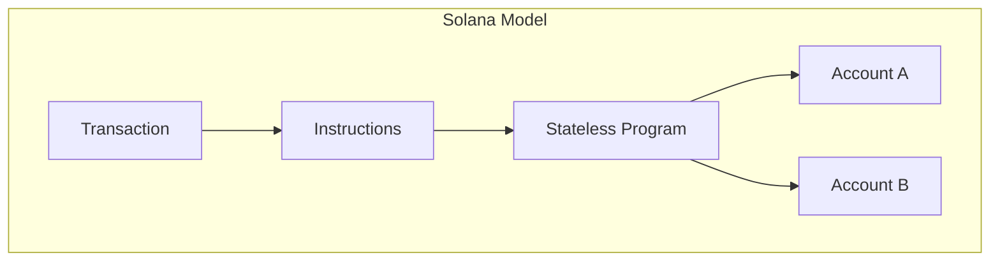
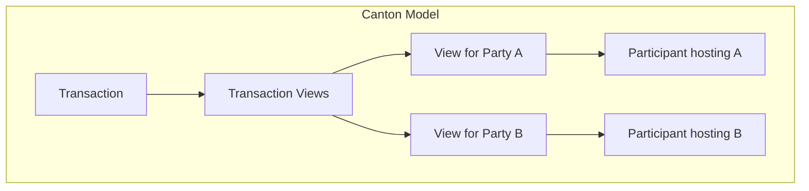

import DamlPartyRolesTemplateStructure from "/snippets/external/daml/main/tutorials-smart-contracts-daml-daml-intro-choices-daml-party-roles-template-structure-begin.mdx";

If you're coming from Solana, several of the mental models carry over less directly than they do from account-based EVM chains. Solana separates programs from the accounts they operate on and schedules execution by declared account access; Canton separates parties and privacy instead. This page maps the concepts that are genuinely different. For concepts that are about Canton generally rather than about translating from Solana specifically, it links out to the shared explanations rather than repeating them.

## Core Concept Mapping

| Solana Concept | Canton Equivalent | Canton Notes |
|-----------------|-------------------|--------------|
| Account (data + owner program + lamports) | Contract | Solana separates data from logic; a Daml template bundles both into one contract |
| Program | Template + choices | Programs are stateless and operate on accounts passed into them; templates define both the data schema and the choices that act on it |
| Instruction | Choice | A Solana transaction bundles one or more instructions; a Canton transaction exercises one or more choices |
| Program Derived Address (PDA) | No direct equivalent | Canton contracts are identified by contract ID, not a deterministic keyless address derived from a program |
| Rent / rent-exemption | No direct equivalent | Canton has no ongoing per-account storage charge; [Traffic](/overview/understand/canton-coin#traffic-transaction-fees) is closer in spirit to gas than to rent |
| Sealevel (parallel execution by declared account access) | No direct equivalent | Canton's concurrency comes from multi-party confirmation and privacy boundaries, not from scheduling transactions by declared read/write sets |
| Validator (executes transactions, Tower BFT consensus) | Synchronizer + Participant | Canton splits these roles: a synchronizer only sequences and orders messages, it does not execute anything; a participant node executes and stores data only for the parties it hosts |
| Global account state (visible to any RPC node) | Distributed state | No node has the full ledger; each participant stores data only for the parties it hosts |

## The Mental Model Shift

**On Solana**: Programs are stateless. You write instruction handlers that read and write data in accounts passed to them explicitly, and the Solana runtime schedules non-conflicting transactions in parallel based on which accounts they declare.

**On Canton**: Templates bundle data and logic together as contracts. Contracts are created and archived, never mutated in place. Concurrency isn't scheduled by declared account access; it comes from how many parties need to confirm a transaction and which contracts they're stakeholders on.





## Programs vs Templates

A Solana program is stateless Rust code, typically written with the [Anchor](https://www.anchor-lang.com/) framework. The program itself holds no data; state lives in separate accounts that get passed into each instruction:

```rust
// Anchor: the program is stateless logic, separate from the data it operates on
#[program]
pub mod token {
    use super::*;

    pub fn transfer(ctx: Context<Transfer>, amount: u64) -> Result<()> {
        let from = &mut ctx.accounts.from;
        let to = &mut ctx.accounts.to;
        from.balance -= amount;
        to.balance += amount;
        Ok(())
    }
}

// State lives here, not in the program
#[account]
pub struct TokenAccount {
    pub owner: Pubkey,
    pub balance: u64,
}

#[derive(Accounts)]
pub struct Transfer<'info> {
    #[account(mut, has_one = owner)]
    pub from: Account<'info, TokenAccount>,
    #[account(mut)]
    pub to: Account<'info, TokenAccount>,
    pub owner: Signer<'info>,
}
```

In Daml, a template bundles the data and the logic that acts on it into a single definition. There's no separate account to pass in: the contract's own fields are the data, and a choice both reads and writes them by archiving the current contract and creating a new one:

<DamlPartyRolesTemplateStructure />

### Key Differences

| Aspect | Solana (Anchor) | Daml |
|--------|----------|------|
| **Where state lives** | Separate accounts, owned by the program | Inside the contract itself |
| **State model** | Mutable account data | Immutable contracts; changes create new contracts |
| **Authorization** | Account ownership and `Signer` checks in the instruction | Compile-time `signatory`/`controller` declarations |
| **Default visibility** | Any account is readable by any RPC node | Private by default; explicit `observer` declarations |
| **Execution scheduling** | Parallelized by declared account access (Sealevel) | Not applicable; concurrency follows from confirmation and privacy, not declared access sets |

Unlike a Solana instruction mutating an account's balance field directly, exercising a Daml choice such as `ChangeOwner` doesn't mutate the existing contract. It **archives** the current contract and **creates** a new one with the new owner. There's also no PDA-equivalent step: a Daml contract doesn't need a deterministic, keyless address computed up front for another party to reference it by. Its contract ID is simply assigned on creation.

## Privacy and Authorization

Solana's account state is visible to anyone with RPC access, much like Ethereum's. Canton's privacy and authorization models work the same way regardless of which chain you're coming from; see [Privacy Model Differences](/appdev/modules/m2-privacy-differences) and the authorization model section of [Canton for Ethereum Developers](/appdev/modules/m2-canton-for-ethereum-devs#authorization-model) for the full explanation, including the `signatory`/`observer`/`controller` roles. The concepts there apply exactly as written; only the starting mental model (account ownership and `Signer` checks, rather than `msg.sender`) differs.

## Developer Tooling Comparison

| Solana Tool | Canton Equivalent | Notes |
|--------------|-------------------|-------|
| Rust | Daml | Both are statically typed; Daml is purpose-built for multi-party workflows rather than general-purpose |
| Anchor | Daml SDK + dpm | Build, test, deploy toolchain |
| Solana Playground / VS Code | VS Code + Daml Extension | IDE with language support |
| Phantom / wallet-adapter | Wallet SDK | User wallet integration |
| Solana RPC (`@solana/web3.js`) | Ledger API (gRPC/JSON) | Application integration |
| SPL Token / Token-2022 | CIP-0056 | [CIP-0056](https://github.com/canton-foundation/cips/blob/main/cip-0056/cip-0056.md) (tokens) |

## What You'll Need to Unlearn

| Solana Habit | Canton Reality |
|----------------|----------------|
| **Designing around rent and rent-exemption** | No ongoing storage rent; design around traffic costs per transaction instead |
| **Deriving a PDA so a program can own an account** | Contracts get a contract ID on creation; there's no deterministic address to derive up front |
| **Thinking about parallel execution by declared account access** | Concurrency comes from confirmation and privacy boundaries, not from an explicit read/write account list |
| **Querying any account from any RPC node** | Query from participants hosting the relevant parties |
| **Mutating account data in place** | State changes create new contracts; old ones are archived |

## Common Gotchas

<Warning>
These are the most common mistakes Solana developers make when first building on Canton.
</Warning>

| Gotcha | Why It Happens | How to Avoid |
|--------|---------------|--------------|
| **Looking for a rent-exemption equivalent** | Solana ties storage cost to an ongoing account balance | Canton's traffic fees are per-transaction, not ongoing; there's nothing to keep "exempt" |
| **Trying to pass a contract like an account into another choice** | Solana instructions take explicit account lists | A Daml choice reads and writes the contract it's exercised on directly; there's no separate account parameter to pass |
| **Assuming you need a PDA-style derived identity** | PDAs are how Solana programs get a keyless, deterministic address | Canton contracts don't need this: a contract ID is assigned on creation, and a party's identity is a cryptographic key, not a program-derived address |
| **Expecting transaction ordering to depend on declared account access** | Sealevel schedules by account read/write sets | Canton ordering comes from the synchronizer sequencing transactions and from confirmation, not from an access-set scheduler |

## Next Steps

- **[Architecture Overview](/overview/learn/architecture)** - Deep dive into Canton's component model
- **[Privacy Model Explained](/overview/learn/privacy-model)** - Understand sub-transaction privacy
- **[Developer Track Module 3: Daml Development](/appdev/modules/m3-dev-environment)** - Start writing Daml code
